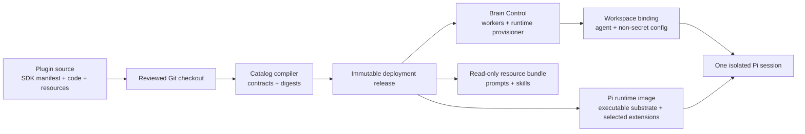

# Plugin model

Plugins are Jarvis's unit of change. A plugin groups the reviewed instructions,
agents, tools, providers, and runtime requirements needed for one capability.
The platform treats that group as one immutable contribution: it is reviewed,
compiled into the catalog from this repository checkout, built into images, and
released together.

Plugin V2 manifests are the only authored production source for agent and
runtime policy. Every production service loads the same immutable compiled
catalog. Versioned V1 request and persistence schemas remain wire-format
contracts, but they are not a second configuration path. Application code that
uses the `AgentCatalog` port receives a read-only projection from the compiled
artifact.



The encapsulation rule is: domain knowledge points inward, platform authority
points outward. A plugin owns its agents, tools, broker and privileged-handler
factories, helper programs, runtime image declarations, validation, tests, and
setup documentation. The platform supplies generic registration, workspace
bindings, credential-reference resolution, durable approvals, audit, catalog
verification, and isolated execution. It must not contain a switch statement,
environment variable, Dockerfile, or command dedicated to one optional plugin.

```text
plugins/<id>/                         generic platform
  manifest + resources  -----------> catalog/compiler + workspace binding
  Pi provider            -----------> tool-provider registry
  broker factory         -----------> approvals + privileged broker transport
  privileged factory     -----------> credential resolver + isolated host
  deploy/runtime.json    -----------> generic plugin image builder
  deploy/Dockerfile
```

This does not mean a plugin can activate itself, read raw credentials from a
binding, approve its own operation, or directly control Docker. Those remain
platform trust-boundary responsibilities.

## The contract

Every plugin has a V2 manifest validated by `@second-brain/plugin-sdk`:

| Manifest area                 | Purpose                                       | Main constraint                                          |
| ----------------------------- | --------------------------------------------- | -------------------------------------------------------- |
| `id`, `version`, `activation` | Stable identity and when it is available      | IDs are durable; activation is explicit                  |
| `agents`                      | Role prompts, skills, model/runtime selection | Each agent belongs to the plugin and declares its limits |
| `resources` and `skills`      | Static prompts, skills, and runtime files     | Paths stay inside the plugin and are digest-covered      |
| local providers               | In-process tools used by Pi                   | Registered through the SDK and bounded by catalog policy |
| broker providers              | Privileged operations outside Pi              | Exposed through a named server-side implementation       |
| approvals and configuration   | Human approval and workspace settings         | A binding may narrow these values, never widen them      |

Agents describe what a session is for. Tools describe what it can ask the
platform to do. Prompts and skills explain safe use; they are not authority.
Authority comes from the catalog, runtime class, workspace binding, approval
policy, filesystem boundary, and server-side enforcement.

For example, Browser observation tools run locally in its isolated runtime,
while `browser_click` and `browser_type` are broker tools. A call records an
owner-required proposal; `/approve` consumes it once and the provisioner sends
only that canonical action back to the existing Browser container. This split
lets a plugin expose useful interaction without turning its prompt or runtime
process into an approval authority.

## Three kinds of contribution

- An agent plugin adds a role: prompt, skills, model choice, and limits.
- A capability plugin adds tools or broker operations and may expose them to
  eligible agents. `browser` is an example.
- A platform-integrated plugin supplies foundational roles or behavior whose
  durable state and lifecycle are part of the control plane.

These can be combined without adding a new central route for every agent. The
catalog compiler checks the closure: referenced agents, tools, providers,
resources, runtime classes, and model IDs must all exist and agree.

At release time, role prompts and skills are published separately from the
executable runtime image. The runtime profile publisher writes a deterministic,
digest-addressed bundle below `RUNTIME_PROFILE_DIR/resource-bundles/` and the
runtime manifest records its digest and relative artifact name. Dynamic Pi
runtimes receive that directory as a read-only mount through
`PI_RESOURCE_ROOT`. The local model definition and plugin-selected executable
extensions remain in the selected runtime image; a resource-only change
therefore does not invalidate executable Docker build contexts.

## Why the system is plugin-centric

The plugin boundary keeps change reviewable and deployment-oriented. A new
capability can be tested and digested as a package, while the core remains
responsible for durable state, scheduling, routing, approvals, and isolation.
It also prevents a prompt or tool from quietly becoming active merely because
someone copied a file into a running container.

The trade-off is deliberate ceremony: plugin changes require catalog
validation, image/release verification, Git/artifact provenance, and
coordinated deployment. That ceremony is the mechanism that makes recovery,
provenance, and durable agent references understandable.

Browser is the reference self-contained capability plugin. It owns an agent,
runtime resources, broker mutations, and a dedicated runtime-class image.
Delegation remains in `core-agents` because grants, child-run accounting, and
durable orchestration are platform semantics. The Orchestrator agent may
reference Browser declaratively, but that does not transfer Browser
implementation into the `core-agents` plugin.
Browser observation can run in its isolated runtime, while every Browser
mutation remains an owner-approved broker proposal before execution.

See [plugin authoring](../development/plugin-authoring.md) for the source
contract and [plugin release](../development/plugin-release.md) for the
promotion lifecycle.
