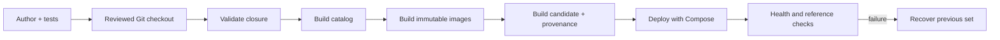

# Plugin authoring and release

Jarvis plugins are reviewed source packages, not code downloaded into a live
agent. A plugin becomes executable only when its reviewed repository checkout is
compiled into a catalog, built into immutable control/runtime images, and
deployed as one release. The Git revision and every artifact/image digest are
recorded as release provenance.

The public extension contract is `@second-brain/plugin-sdk` v1. The built-in
agents, Browser, and sample plugin use its manifest and Pi tool-provider
interfaces.
Manifest document revisions remain explicit integers; they are compatibility
markers, not independent plugin release versions.

## The promotion path



Each step produces an input for the next one. Generated catalogs and release
files are regenerated from the reviewed checkout rather than edited by hand.

## SDK v1 compatibility contract

SDK v1 is frozen at three independently checked boundaries:

- SDK major `1` covers the exported authoring helpers and provider interfaces.
- plugin manifest schema `2` covers the source manifest accepted by the catalog compiler.
- plugin API schema revision `1` covers the immutable deployment release contract.

The authoritative constants and the exact public runtime-export snapshot live
in `@second-brain/plugin-sdk`. Manifest validation and release verification reject
different major/API revisions, while manifest parsing rejects a different
document schema. Plugin packages have no independent semantic version or
runtime upgrade path: an update replaces reviewed source under its stable ID
and ships in a coordinated deployment release.

Within SDK major 1, optional fields and new helpers may be added only when old
plugins retain identical meaning and continue to compile. Removing or renaming
an export, making an optional field required, changing provider lifecycle or
security semantics, or accepting a previously forbidden capability is breaking
and requires a new SDK major or explicit schema/API revision plus coordinated
compiler and runtime support. Deprecations remain supported for the lifetime of
v1; migration is rehearsed before removal in a later major.

## Create and test a plugin

Create a general plugin or the narrower one-agent template:

```bash
pnpm plugin:new <plugin-id>
pnpm agent:new <agent-id>
```

The general scaffold produces one valid V2 SDK contribution, one safe isolated
agent, package exports, tests, resources, and TypeScript project references.
There is no parallel YAML manifest. Keep stable IDs once durable data can
reference them. Keep every resource beneath the plugin package and register
local tool implementations through the SDK provider interface.

`example-echo` is the reference secretless workspace plugin. Its `echo` agent
has no filesystem, process, network, approval, or external side-effect
capability. Use it to follow the complete workflow without credentials.

After reviewing and staging the intended plugin files, validate the package
closure:

```bash
git add plugins/<plugin-id>
pnpm plugin:validate
pnpm plugin:test
pnpm plugin:docs
pnpm verify
```

Validation checks manifest identity and activation, agent and
tool/provider closure, and the conventional resource tree. `plugin:docs-check` is included
in `verify`; generated output is [the plugin catalog](../reference/installed-plugins.md).

## What gets verified

- `plugin:validate` checks identity, activation, agent/tool/provider closure,
  and resource path safety.
- `plugin:test` runs plugin and SDK tests, including denied-operation cases.
- `catalog:build` resolves the installed composition and pins runtime/model
  images; `catalog:verify` recomputes its digest and closure.
- `platform:release deploy` packages and verifies the catalog, runtime manifest,
  model catalog, database compatibility, Git revision, and immutable image IDs
  before deploying them together.

The Pi image is assembled from the curated runtime and resources declared by
installed manifests. It does not install plugins at container startup. Browser
dependencies are isolated in the browser runtime image.

## Bind a workspace plugin

`activation: "built-in"` contributions are always active in their compiled
release. `activation: "workspace"` contributions, including `example-echo`,
need an enabled workspace/plugin binding that names only eligible agent IDs and
valid configuration. Missing, disabled, ineligible, or credential-incomplete
bindings fail closed at discovery and job claim time. A binding never expands
catalog, runtime, delegation, broker, or approval ceilings.

## Build and verify the catalog

Use immutable image IDs for all runtime classes:

```bash
pnpm catalog:build -- --output <catalog.json> \
  --runtime-image base=sha256:<64-hex> \
  --runtime-image isolated=sha256:<64-hex> \
  --runtime-image browser=sha256:<64-hex>

pnpm catalog:verify -- --output <catalog.json> \
  --runtime-image base=sha256:<64-hex> \
  --runtime-image isolated=sha256:<64-hex> \
  --runtime-image browser=sha256:<64-hex>
```

The compiler resolves the installed composition from this repository checkout;
no external plugin registry or lock file is consulted. Any prompt, skill, extension, provider,
configuration, or policy change produces new content and catalog digests.

## Deploy one deployment release

A release contains the catalog, runtime manifest, model catalog, their digests,
the reviewed Git revision, the control-plane image ID, every runtime-class
image ID, the database compatibility range, and plugin API schema revision.
After building the affected catalog and images, the owner-facing command
packages and verifies them, backs up, preflights migrations, and deploys the
candidate. Run it from the clean reviewed checkout; it rejects staged,
unstaged, or untracked source:

```bash
pnpm platform:release deploy -- \
  --catalog <catalog.json> \
  --runtime-manifest <current-runtime.json> \
  --model-catalog deploy/pi-runtime/models.json \
  --control-image sha256:<64-hex> \
  --minimum-migration 1 \
  --maximum-migration 4 \
  --release-root <immutable-release-directory> \
  --state-root <release-state-directory> \
  --catalog-target <PLATFORM_CATALOG_DIR>/platform-catalog.v2.json \
  --runtime-manifest-target <RUNTIME_PROFILE_DIR>/current-runtime.json \
  --backup-directory <backup-directory>
```

Staging uses a temporary directory and atomic rename. Verification rejects
unsafe artifact paths, symlinks, digest drift, non-immutable
images, runtime/catalog mismatch, an agent model absent from the released model
catalog, incompatible database levels, and missing durably referenced agents.

## Recover with Compose

Deployment and recovery use the production Compose deployment adapter. Pass
host paths mounted by Compose, never container paths. To recover, first check
out the Git revision and configure Compose image references recorded for the
previous deployment; recovery refuses an unrelated checkout or image set:

```bash
pnpm platform:release recover -- \
  --state-root <release-state-directory> \
  --catalog-target <PLATFORM_CATALOG_DIR>/platform-catalog.v2.json \
  --runtime-manifest-target <RUNTIME_PROFILE_DIR>/current-runtime.json \
  --backup-directory <backup-directory>
```

Optional `--project-root`, `--project-name`, `--env-file`, and `--compose-file`
override production defaults.

The adapter checks the configured Compose control image, reads the migration
ledger and every durable agent reference from PostgreSQL, snapshots current
artifacts and `pg_dump`, stops inbound workers/schedulers, applies only ordered
additive migrations inside the release's maximum, atomically publishes the
artifacts, force-recreates catalog consumers with `--no-build --wait`, then resumes
workers. The public schema starts at migration 1; this checkout has ordered
additive migrations through migration 4. An absent or invalid public ledger
fails closed. A deployment failure restores artifact files and attempts to
restart the prior stack before the release pointer can change.

Every additive migration after the public baseline must advance the singleton
`brain_core.schema_metadata` marker in the same migration. Adjacent releases
should use overlapping compatibility ranges so the deployer can apply the new
migration while the previous release remains forward-compatible for rollback.

Recovery deploys and verifies `previous.json` before rotating pointers. Schema
changes are not destructively reversed, so the previous release must declare a
forward-compatible database maximum that includes the current additive schema.

## Replace, deprecate, and retire

Update plugin source in place under its permanent ID, then build a new immutable
deployment release. Never patch executable code inside
a running service. Prefer additive schema changes; a breaking manifest or SDK
shape requires a new explicit schema revision and coordinated runtime support.

Deprecation keeps the contribution available while bindings and durable work
migrate. Before removing a workspace plugin, generate a reviewable plan:

```bash
pnpm plugin:retire -- --plugin example-echo \
  --referenced-agents <durable-reference-evidence.json> \
  --output <retirement-plan.json>
```

Durable-reference evidence is always required, including when its `agentIds`
array is empty. If it names retired agents, also pass JSON inputs with
`--active-bindings` and a complete `--mapping` to non-retired agents.
`--manifests` may override the installed composition. The
planner never mutates the database or source and always emits
`migrated: false`; apply and review the data migration separately. Active
bindings block retirement. After references are cleared, remove the package
from installed composition/workspace config, validate, and deploy a new
release. Retired IDs are recorded in `plugins/retired-identifiers.json` and may
never be reused. Historical rows remain readable for audit, but retired IDs
are rejected for new execution. Deployment independently rejects any catalog
that omits a still-referenced agent.

## Resource-only updates

When only prompts, skills, or other read-only resource files change, publish a
new digest-addressed resource bundle without rebuilding executable images:

```bash
node scripts/runtime/update-host-local-runtime-profile.mjs --resources-only
```

The runtime still verifies the catalog and resource digest, and consumers are
reloaded together. Executable, model, dependency, or policy changes require a
normal `platform:release deploy`.
